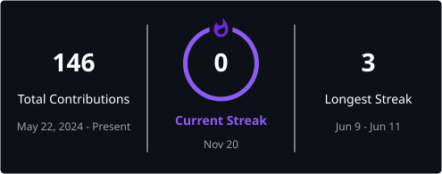

<div align="center">


<a href="https://git.io/typing-svg">

</a>

<br/>

[](https://www.srmist.edu.in/)
[](https://www.srmist.edu.in/)
[](https://www.google.com/maps/place/Chennai)

<br/>

<a href="https://linkedin.com/in/sakthi-prabhu">

</a>
<a href="mailto:rsakthiprabhu2005@gmail.com">

</a>
<a href="https://github.com/prabhhhuu">

</a>

<br/><br/>


</div>

---

## About

I am a **BCA graduate and MERN Stack Developer** focused on building responsive, component-based web applications with **React.js, Node.js, Express.js, REST APIs, and MongoDB**.

My primary strength is frontend development, with hands-on experience building reusable React interfaces, responsive layouts, state-driven applications, API integrations, and deploying applications using **Vercel and Railway**.

I also work with **Python, FastAPI, Flask, LangChain and Generative AI** — most recently on a full-stack internship where I loaded 27,000+ IDSP and WHO surveillance records into Pinecone so the system could answer outbreak questions with context, and a Generative AI internship building a LangChain chatbot on Gemini and ChromaDB.

I approach development with a practical engineering mindset: understand the requirement, build maintainable components, integrate APIs, test the application, debug issues, and maintain a clean codebase.

### Open To

- Frontend Developer roles
- React.js / MERN Stack opportunities
- Full Stack Developer opportunities
- AI-integrated web application projects
- Open-source collaboration
- Entry-level software engineering roles

---

## Tech Stack

### Languages

<p align="center">


</p>

### Frontend

<p align="center">


</p>

### Backend & Databases

<p align="center">


</p>

### Cloud, DevOps & Tooling

<p align="center">


</p>

---

## AI / ML Expertise

| Domain | Proficiency | Details |
|---|---|---|
| **Generative AI** | Practical | Built an AI chatbot during a Generative AI internship |
| **LangChain** | Practical | Implemented conversational memory for an AI chatbot |
| **AI Application Integration** | Practical | Contributed to UI and API-integration work for AI applications |
| **Retrieval-Augmented Generation** | Practical | Indexed 27,000+ IDSP and WHO surveillance records in Pinecone with per-source namespaces |
| **Python** | Practical | Built a Flask + Groq AI tutor and a LangChain chatbot prototype |
| **FastAPI / Flask** | Exposure | Backend frameworks used for Python-based development |

---

## Featured Projects

<details>
<summary><strong>Dynamic Image Gallery — React.js</strong></summary>

<br/>

A component-based React image gallery featuring state-driven filtering and dynamic rendering.

| Category | Details |
|---|---|
| **Stack** | React.js |
| **Scale** | Component-based frontend application |
| **Performance** | State-driven rendering and reusable components |
| **Security** | No sensitive application data documented |
| **Impact** | Demonstrates React state management and reusable UI architecture |
| **Repository** | [GitHub](https://github.com/prabhhhuu) |

</details>

<details>
<summary><strong>Favourite Student List — React.js</strong></summary>

<br/>

A React application using Context API for global state management and Tailwind CSS for styling.

| Category | Details |
|---|---|
| **Stack** | React.js, Context API, Tailwind CSS |
| **Scale** | Frontend application |
| **Performance** | Centralized state management with reusable UI |
| **Security** | No sensitive application data documented |
| **Impact** | Demonstrates global state handling and component-driven development |
| **Repository** | [GitHub](https://github.com/prabhhhuu) |

</details>

<details>
<summary><strong>BetBillsBot — Node.js Telegram Bot</strong></summary>

<br/>

A Node.js Telegram bot deployed on Railway with an automated event-triggered welcome flow for new members.

| Category | Details |
|---|---|
| **Stack** | Node.js, Telegram Bot API, Railway |
| **Scale** | Event-driven bot application |
| **Performance** | Automated event-triggered workflow |
| **Security** | Configuration secured through environment variables |
| **Impact** | Automates member onboarding interactions |
| **Repository** | [GitHub](https://github.com/prabhhhuu) |

</details>

<details>
<summary><strong>RedStore — Responsive E-Commerce Website</strong></summary>

<br/>

A responsive storefront built with HTML5, CSS3, and JavaScript featuring live search and filtering.

| Category | Details |
|---|---|
| **Stack** | HTML5, CSS3, JavaScript, Tailwind CSS |
| **Scale** | Responsive frontend storefront |
| **Performance** | Rebuilt the Tailwind CSS build pipeline and reduced output size |
| **Security** | No sensitive application data documented |
| **Impact** | Restored consistent styling and improved build output |
| **Repository** | [GitHub](https://github.com/prabhhhuu) |

</details>

---

## Experience

### Full Stack Engineer Intern

**Asvix**  
*September 2026 – November 2026*  
*Chennai, Tamil Nadu*

- Loaded and organised 27,000+ normalised surveillance records from IDSP and WHO sources into Pinecone so the system could give context-aware answers on disease outbreaks.
- Split IDSP and WHO data into two separate Pinecone namespaces to prevent data mixing across sources.
- Worked around Pinecone's 40 KB metadata limit by storing report excerpts and fetching the full content on demand, which let large reports load reliably.
- Tested the APIs with 33 checks (27 offline tests and 6 live checks), covering response accuracy, data consistency and error handling.

**Skills:** `Pinecone` `RAG` `API Testing` `Data Engineering`

### Generative AI Intern

**Sinthan AI Academy**  
*June 2025 – July 2025*  
*Chennai, Tamil Nadu*

- Built a multi-service prototype AI chatbot with Python, LangChain, Flask and Next.js, working under a senior developer's guidance.
- Connected the Google Gemini API to generate natural conversational replies.
- Stored documents in ChromaDB Cloud and used retrieval to give context-aware answers.
- Handled API integration and debugging to make the prototype more dependable.

**Skills:** `Python` `LangChain` `Generative AI` `Flask` `Next.js` `ChromaDB` `Gemini API`

---

## Open-Source Contribution

### WareFlow — Inventory & Warehouse Management Tool

Collaborative GitHub project contribution focused on frontend improvements and repository hygiene.

- Redesigned `review.html` using Tailwind CSS.
- Coordinated changes through Git and GitHub.
- Avoided modifying unrelated project files.
- Cleaned repository hygiene issues including accidentally tracked `node_modules` and build artifacts.

**Skills:** `HTML` `Tailwind CSS` `Git` `GitHub` `Repository Management`

---

## Achievements

<div align="center">

| Recognition | Details |
|---|---|
| **BCA Graduate** | Bachelor of Computer Applications, SRM Institute of Science and Technology |
| **Academic Performance** | Graduated with a CGPA of 7.58 |
| **Higher Secondary** | Achieved 87% in Higher Secondary Education |
| **Internship Experience** | Completed Full Stack Engineering and Generative AI internships |
| **Open-Source Contribution** | Contributed frontend and repository-hygiene improvements to a collaborative GitHub project |

</div>

---

## Certifications

### Sinthan AI Academy

[](https://ai.google/)

### errormakesclever

[](https://openai.com/)

---

## GitHub Analytics

<div align="center">





<br/><br/>



</div>

---

## GitHub Trophies

<div align="center">


</div>

---

## Contribution Snake

<div align="center">


</div>

---

## Current Focus

```yaml
Learning:
  - Advanced React.js
  - Full Stack Development
  - REST API Architecture
  - Generative AI
  - LangChain
  - Retrieval-Augmented Generation

Building:
  - Responsive React Applications
  - MERN Stack Projects
  - API-Integrated Web Applications
  - AI-Enabled Applications
  - RAG-Backed Applications

Exploring:
  - AI Application Development
  - Backend Engineering
  - Open Source Collaboration
  - Production Deployment

Open To:
  - Frontend Developer Roles
  - MERN Stack Opportunities
  - Full Stack Developer Roles
  - AI-Integrated Development Projects
  - Open Source Collaboration
```

---

## Connect

<div align="center">

<a href="mailto:rsakthiprabhu2005@gmail.com">

</a>

<a href="https://linkedin.com/in/sakthi-prabhu">

</a>

<a href="https://github.com/prabhhhuu">

</a>

<a href="https://personal-portfolio-nine-mu-51.vercel.app/">

</a>

</div>

---

<div align="center">


</div>
